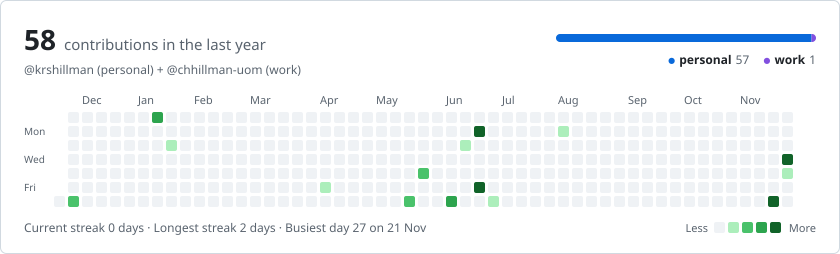
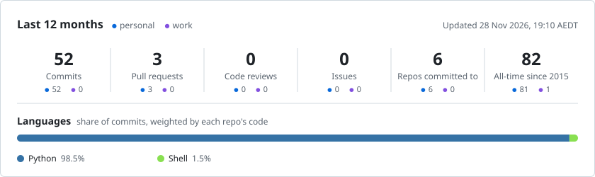

# Hi, I'm Chris

**Data Engineering & Analytics Manager at the University of Melbourne.**
I've led data engineering and analytics teams in regulated environments, and I write about the practice of data engineering at [**Ghost in the Data**](https://ghostinthedata.info).

## Personal + work, combined

<picture>
  <source media="(prefers-color-scheme: dark)" srcset="https://raw.githubusercontent.com/krshillman/krshillman/profile-assets/contributions-dark.svg">
  
</picture>

<picture>
  <source media="(prefers-color-scheme: dark)" srcset="https://raw.githubusercontent.com/krshillman/krshillman/profile-assets/overview-dark.svg">
  
</picture>

My day job happens on a separate account, [@chhillman-uom](https://github.com/chhillman-uom), so these cards merge both. Work in private repositories (personal or organisation) is counted but never named; public repositories are linked. Refreshed every 6 hours by [a workflow in this repo](https://github.com/krshillman/krshillman/blob/main/.github/workflows/update-readme.yml).

### Recent activity

<!-- profile:activity:start -->
- 🔨 Pushed **1 commit** to [ghostinthedata-info/retrospectives](https://github.com/ghostinthedata-info/retrospectives) · personal · 26 Nov
- 🔀 Opened PR [#1](https://github.com/krshillman/krshillman/pull/1) in [krshillman/krshillman](https://github.com/krshillman/krshillman): Combine personal and work accounts into one profile (merged) · personal · 25 Nov
- 🔨 Pushed **3 commits** to [krshillman/krshillman](https://github.com/krshillman/krshillman) · personal · 25 Nov
- 🔨 Pushed **27 commits** to [ghostinthedata-info/skills](https://github.com/ghostinthedata-info/skills) · personal · 21 Nov
<!-- profile:activity:end -->

### Latest writing

<!-- profile:blog:start -->
- [Nobody Reads 7,000 Words the Night Before an Interview](https://ghostinthedata.info/posts/2026/2026-11-21-night-before-the-interview/) · 21 Nov 2026
- [Very Boring but Very Responsible](https://ghostinthedata.info/posts/2026/2026-11-15-supervisory-engineering-data-managers/) · 15 Nov 2026
- [World Building: Your World Still Needs a Why](https://ghostinthedata.info/posts/2026/2026-10-30-handlers-vault-part-1/) · 30 Oct 2026
- [The Style Isn't the Skill](https://ghostinthedata.info/posts/2026/2026-08-31-style-isnt-the-skill/) · 31 Aug 2026
- [AWS MWAA: The Practitioner's Unvarnished Guide](https://ghostinthedata.info/posts/2026/2026-07-18-mwaa-unvarnished-guide/) · 18 Jul 2026
<!-- profile:blog:end -->

### Tools I work with

